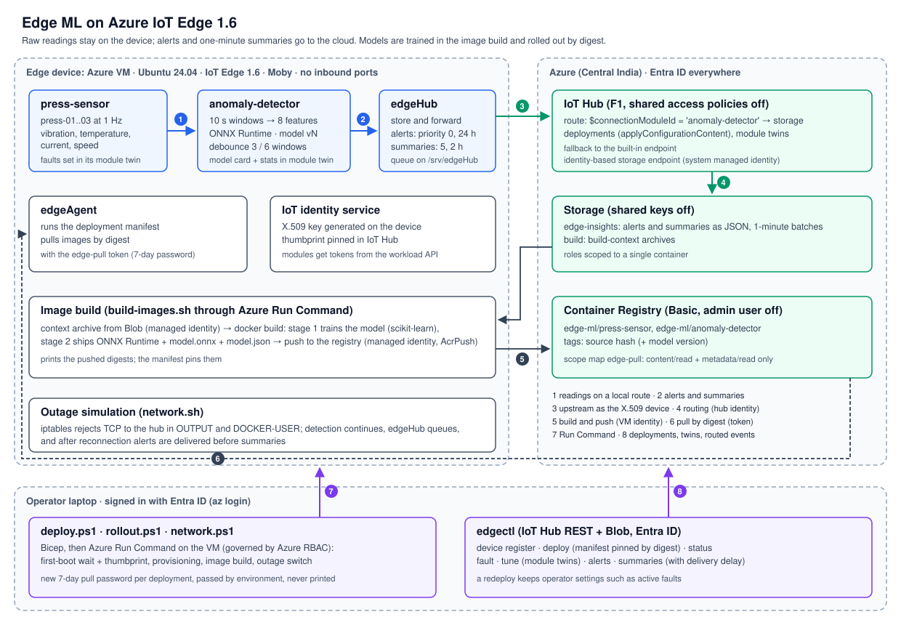
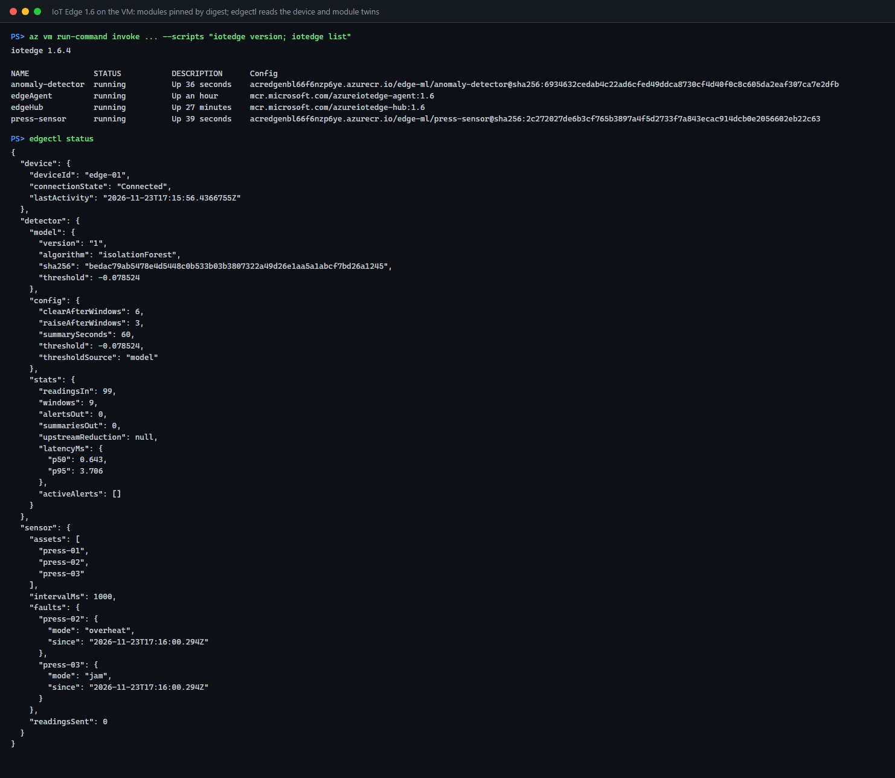
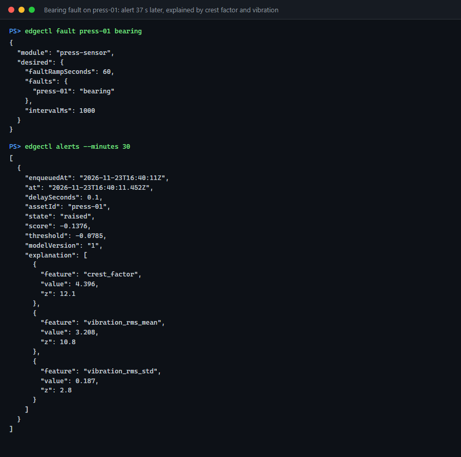
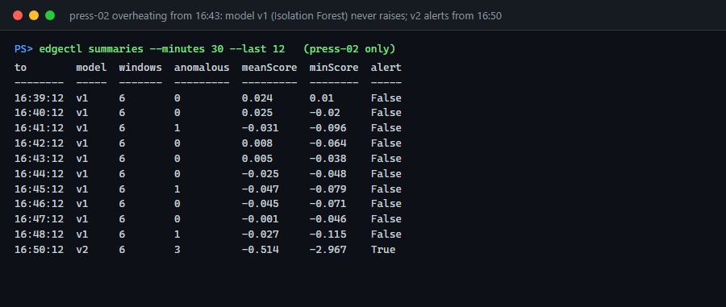
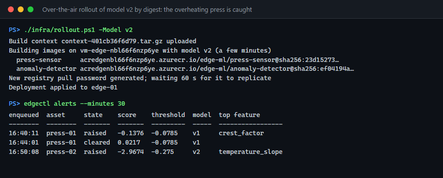
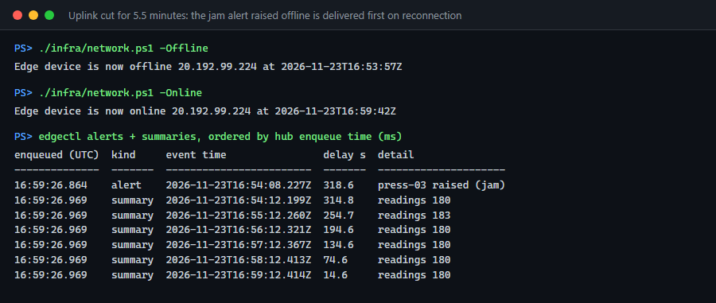
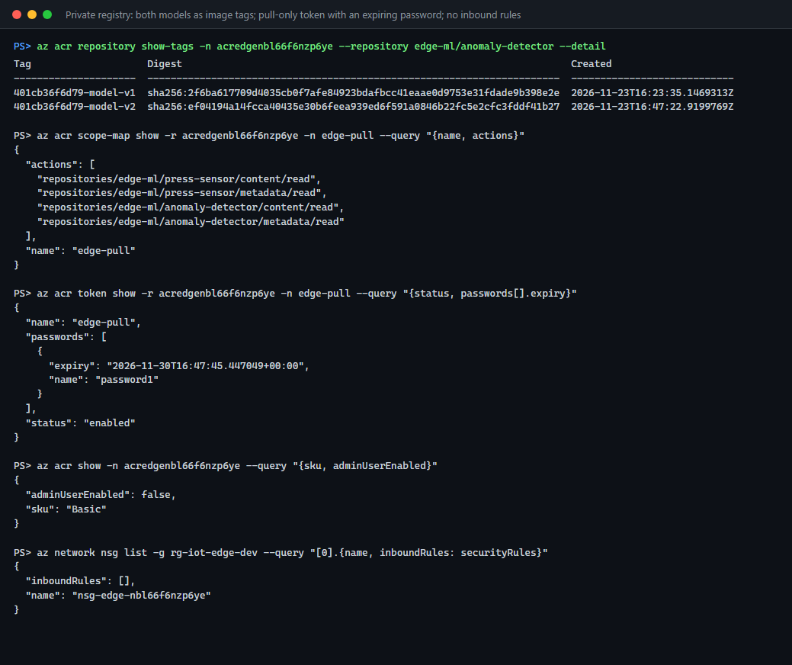
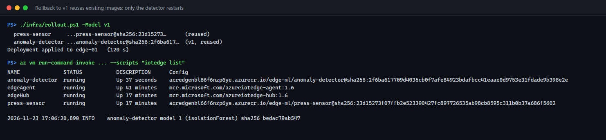

# Azure IoT Edge ML: Anomaly Detection at the Edge

> Anomaly detection on Azure IoT Edge 1.6:
> - Unsupervised ONNX models are trained from code inside the image build and rolled out over the
>   air by digest.
> - Raw sensor data stays on the device; only alerts and summaries reach the cloud.
> - The device keeps detecting through uplink outages.



An Ubuntu 24.04 VM runs IoT Edge 1.6 as the edge device for a line of three presses.
- A **sensor module** samples vibration, temperature, current, and speed once a second.
- A **detector module** cuts the readings into 10-second windows, scores them with an ONNX model,
  and raises an alert after three anomalous windows in a row, naming the signals that look wrong.
- **Uplink:** only alerts and a one-minute summary leave the device, through the IoT Edge hub's
  prioritised store-and-forward queue. IoT Hub routes them to Blob storage, where `edgectl` reads
  them.
- **Models:** each one is trained deterministically in the first stage of its image build, ships
  with a model card, and is deployed by image digest. Rolling out a new version is one command.

## What it demonstrates

| Capability | How |
|------------|-----|
| **IoT Edge 1.6** | Deployment manifest with edgeAgent and edgeHub 1.6, modules pinned by digest, persistent host storage, memory limits, desired properties ([ADR 0001](docs/adr/0001-edge-host-and-image-pipeline.md)) |
| **Edge ML** | Window features, unsupervised One-Class SVM vs Isolation Forest, threshold from a validation quantile, debounce, z-score explanations ([ADR 0003](docs/adr/0003-anomaly-detection.md)) |
| **Model as code** | Seeded training in a build stage, ONNX export checked against scikit-learn, model card with sha256 and metrics, rollout and rollback by digest ([ADR 0002](docs/adr/0002-model-as-code.md)) |
| **Bandwidth** | Raw readings on a local route; one summary a minute plus alerts upstream, against 259,200 raw readings a day ([ADR 0004](docs/adr/0004-bandwidth-and-offline.md)) |
| **Offline operation** | Route priorities and TTLs, alerts first after an outage; delivery delay measured per message |
| **Operations** | `edgectl`: register, deploy, status, inject faults, retune, and read alerts and summaries through module twins and routed events |

### The two models

| Model | Algorithm | False alerts per press-day | Recall: bearing / overheat / jam |
|---|---|---|---|
| v1 | Isolation Forest | 0 | 1.00 / **0.04** / 0.92 |
| v2 | One-Class SVM on standardized features | 0 | 1.00 / **1.00** / 1.00 |

v1 misses a press that overheats while everything else looks normal. Isolation Forest splits only
inside its training range, so a reading far past that range scores like the edge of healthy.
Rolling out v2 fixes that blind spot, and the test suite pins this behaviour.

## Security

- **Device identity born on the device:**
  - The device generates its EC P-256 key at first boot. Only the IoT keys service can read it.
  - IoT Hub pins the certificate's thumbprint.
  - Modules authenticate through the IoT Edge workload API.
- **No inbound access:**
  - No NSG inbound rules and no usable SSH key.
  - Management goes through Azure Run Command under Azure RBAC.
- **No shared keys:**
  - The hub's shared access policies, the storage account's shared keys, and the registry's admin
    user are all disabled.
  - The hub routes to storage, and the VM reads build inputs and pushes images, with managed
    identities.
- **Least privilege:**
  - Every storage role is scoped to one container.
  - The device's registry token reads two repositories only, and its password expires in 7 days.
    Each deployment issues a new one, and it is never printed or written to disk
    ([ADR 0005](docs/adr/0005-device-identity-and-access.md)).

## Quickstart

**Prerequisites:** Python 3.12+, Azure CLI (`az login`, `az bicep install`), and a subscription
with no existing free IoT hub (Azure allows one per subscription). No local Docker is needed: the
images are built on the edge VM.

```powershell
# 1. Python environment
python -m venv .venv; .venv\Scripts\activate
pip install -r requirements-dev.txt

# 2. Azure: IoT Hub, registry, storage, and the edge VM; registers the device, builds the images
#    on the VM, and deploys model v1 (about 15 minutes)
./infra/deploy.ps1

# 3. Runtime, modules, model, and detector statistics
python -m service status

# 4. A failing bearing on press-01: an alert within about two minutes
python -m service fault press-01 bearing
python -m service alerts --minutes 15

# 5. An overheating press-02: model v1 stays silent
python -m service fault press-01 none
python -m service fault press-02 overheat

# 6. Roll out model v2; it catches the overheating press (the fault stays active)
./infra/rollout.ps1 -Model v2
python -m service status
python -m service alerts --minutes 15

# 7. Cut the uplink, wait a few minutes, restore it: queued messages arrive late, alerts first
./infra/network.ps1 -Offline
./infra/network.ps1 -Online
python -m service summaries --minutes 20 --last 10

# 8. Remove everything
./infra/teardown.ps1
```

`edgectl` (installed by `pip install -e .`) is the same CLI as `python -m service`. Its exit codes:

| Code | Meaning |
|---|---|
| `0` | Success |
| `1` | Operation failed |
| `2` | Invalid input or configuration |

## Verified live

Run end to end on Azure on 2026-11-23 (Central India, free hub, IoT Edge 1.6.4), then torn down.

| Step | Result |
|------|--------|
| Deploy | VM first boot installs Moby and IoT Edge; the device key is generated on the VM; the IoT Edge device is registered by thumbprint. The VM builds both images and pushes them with its managed identity; the device pulls them by digest with the pull-only token |
| Bearing fault (press-01) | Alert raised 37 s after injection, explained by crest factor (z 12.1) and vibration (z 10.8); cleared after the fault was removed |
| Overheating (press-02) | Model v1 stayed silent for six minutes (0–1 anomalous windows a minute) |
| Model rollout | `rollout.ps1 -Model v2` in about 2 minutes; v2 raised the overheating alert 59 s after the sensor resumed |
| Uplink outage | 5.5 minutes offline; a jam alert raised 11 s into the outage reached the cloud 318.6 s after it happened, enqueued 105 ms ahead of the six queued summaries; no readings were lost |
| Rollback | `rollout.ps1 -Model v1` reused both existing images; only the detector restarted |
| Edge figures | 180 readings a minute in, one summary a minute out; ONNX inference p50 1.3 ms, p95 4–5 ms |









## Tests and CI

```powershell
ruff check . ; ruff format --check . ; pytest
```

The suite covers:
- the press physics and features;
- training: reproducibility, ONNX parity, both models' detection metrics, and v1's overheat blind
  spot;
- the detector, run end to end with ONNX Runtime;
- both module runtimes against a fake module client;
- the manifest, the CLI, the routed-event reader, the packager, and the cloud-init and VM scripts.

No Azure is needed to run it. GitHub Actions runs:
- lint, format, and tests on Python 3.12 and 3.13;
- the Bicep build, ShellCheck, and cloud-init validation;
- both images built from the packaged context, then a check that the model in the detector image
  matches its card.

## Project layout

```
edgeml/        shared by modules and training: readings, press physics, features, model card, debounce
ml/            training pipeline and model configs (models/v1.json, v2.json)
modules/       press-sensor and anomaly-detector: Dockerfiles and module runtimes
service/       edgectl: IoT Hub REST and Blob with Entra ID, deployment manifest
infra/         Bicep, cloud-init and VM scripts (edge/), deploy, rollout, network, teardown
tests/         unit and integration tests with in-memory fakes
docs/          architecture diagram, ADRs, screenshots
```

## Cost

**About $1.40 a day while deployed:**
- the VM (`Standard_B2als_v2`): about $1;
- the registry (Basic), public IP, and disk: about $0.40;
- the free IoT hub and the storage: nothing or cents.

The VM shuts down at 23:00 (Pakistan Standard Time) every day in case teardown is forgotten. Run
`infra/teardown.ps1` when finished.

Upstream traffic is a few thousand messages a day, about half the free hub's 8,000. Sending raw
readings would exceed that quota thirty times over.

## Design decisions

- [ADR 0001](docs/adr/0001-edge-host-and-image-pipeline.md): edge host and image pipeline
- [ADR 0002](docs/adr/0002-model-as-code.md): model as code, trained in the image build
- [ADR 0003](docs/adr/0003-anomaly-detection.md): unsupervised anomaly detection on feature windows
- [ADR 0004](docs/adr/0004-bandwidth-and-offline.md): raw data stays local; store and forward for the rest
- [ADR 0005](docs/adr/0005-device-identity-and-access.md): device identity and access
